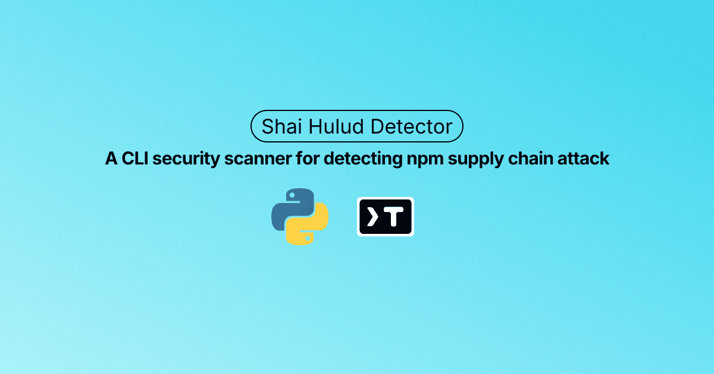

# Shai Hulud Detector

[](https://github.com/ysskrishna/shai-hulud-detector/blob/main/LICENSE)

[](https://pypi.org/project/shai-hulud-detector/)
[](https://pepy.tech/projects/shai-hulud-detector)
[](https://ysskrishna.space)
[](https://context7.com/ysskrishna/shai-hulud-detector)
[](https://deepwiki.com/ysskrishna/shai-hulud-detector)

A CLI tool to detect potential Shai Hulud npm-worm compromises in GitHub users and organizations.



## What is Shai Hulud?

Shai Hulud is a self-replicating npm worm that spreads through compromised developer systems,
infecting GitHub repositories and injecting malicious code.  
It has already been linked to multiple global supply-chain attacks targeting major npm libraries.

This tool scans for known indicators of compromise (IOCs), including:

- Suspicious repository descriptions containing  
  **`"Sha1-Hulud: The Second Coming."`**
- Presence of suspicious JSON files containing secrets, credentials or environment configuration

## Features

- Scan individual GitHub users
- Scan all members of a GitHub organization
- Dual detection methods: repository description patterns and suspicious file detection
- Concurrent scanning with configurable workers
- Color-coded output for easy identification (FLAG/OKAY/ERROR status)
- Detailed verbose mode

## Requirements

- Python 3.11+
- GitHub Personal Access Token (https://github.com/settings/tokens)

## Installation

Install directly from PyPI:

```bash
pip install shai-hulud-detector
```

## Authentication

Set your GitHub token as an environment variable (recommended):

```bash
export GITHUB_TOKEN=<GITHUB_TOKEN_HERE>
```

Or pass it via command-line flag (see Usage section below). If omitted, the tool exits with a clear warning.

## Usage

<a id="scan-one-or-more-users"></a>

<details>
<summary><b>Scan one or more users</b></summary>

```bash
shai-hulud-detector scan <USERNAME_HERE>
shai-hulud-detector scan <USERNAME_HERE1> <USERNAME_HERE2> <USERNAME_HERE3>
```

</details>

<a id="scan-all-members-of-an-organization"></a>

<details>
<summary><b>Scan all members of an organization</b></summary>

```bash
shai-hulud-detector scan --org <ORGANIZATION_NAME_HERE>
```

</details>

<a id="authentication-via-command-line"></a>

<details>
<summary><b>Authentication via command-line</b></summary>

```bash
shai-hulud-detector scan <USERNAME_HERE> --token <GITHUB_TOKEN_HERE>
```

</details>

<a id="help"></a>

<details>
<summary><b>Help</b></summary>

```bash
shai-hulud-detector scan --help
```

</details>

<a id="parallelism"></a>

<details>
<summary><b>Parallelism</b></summary>

Set concurrency (default 5):

```bash
shai-hulud-detector scan --org <ORGANIZATION_NAME_HERE> --workers 10
```

</details>

<a id="verbose-output"></a>

<details>
<summary><b>Verbose Output</b></summary>

```bash
shai-hulud-detector scan <USERNAME_HERE> --verbose
```

</details>

<a id="command-reference"></a>

<details>
<summary><b>Command reference</b></summary>

`shai-hulud-detector scan [OPTIONS] [USERNAMES]...`

| Option | Short | Type | Default | Description |
| --- | --- | --- | --- | --- |
| `USERNAMES` | | text, one or more | none | GitHub usernames to scan |
| `--org` | `-o` | text | none | GitHub organization whose members are all scanned |
| `--token` | `-t` | text | `GITHUB_TOKEN` environment variable | GitHub token |
| `--workers` | `-w` | integer | `5` | Number of concurrent workers |
| `--verbose` | `-v` | flag | off | Show verbose output, including repository counts |

</details>

### Recommended Actions

If you detect a compromise (FLAG status):

- Rotate **all** GitHub, npm, cloud, and CI/CD secrets
- Enforce MFA on GitHub & npm accounts
- Check GitHub for repositories with the description "Sha1-Hulud: The Second Coming."
- Review and remove any suspicious files found (e.g., `secrets.json`, `credentials.json`, etc.)
- Disable npm `postinstall` scripts in CI where possible
- Audit all npm dependencies and versions

### References

For more detailed information about Shai Hulud attacks, see:

- [HelixGuard: Malicious Sha1Hulud Analysis](https://helixguard.ai/blog/malicious-sha1hulud-2025-11-24)
- [Aikido Security: Shai Hulud Strikes Again](https://www.aikido.dev/blog/shai-hulud-strikes-again-hitting-zapier-ensdomains)
- [Wiz: Shai Hulud 2.0 Ongoing Supply Chain Attack](https://www.wiz.io/blog/shai-hulud-2-0-ongoing-supply-chain-attack)

## Development

For development setup, building, and contributing, see [DEVELOPMENT.md](https://github.com/ysskrishna/shai-hulud-detector/blob/main/DEVELOPMENT.md).

## Releases

For information on the release process and how to create new releases, see [RELEASE.md](https://github.com/ysskrishna/shai-hulud-detector/blob/main/RELEASE.md).

## Contributing

Contributions are welcome! Please feel free to submit a Pull Request.

## Built and maintained by

Shai Hulud Detector is built and maintained by:

| | Name | GitHub | Role |
|---|------|--------|------|
|  | **Y. Siva Sai Krishna** | [@ysskrishna](https://github.com/ysskrishna) | Creator |

## Changelog

See [CHANGELOG](CHANGELOG.md) for release history.

## Support

If you find this library helpful:

- ⭐ Star the repository
- 🐛 [Report issues](https://github.com/ysskrishna/shai-hulud-detector/issues)
- 🔀 Submit pull requests
- 💝 [Sponsor on GitHub](https://github.com/sponsors/ysskrishna)

## License

MIT © [Y. Siva Sai Krishna](https://github.com/ysskrishna) — see [LICENSE](LICENSE) for details.

---

<p align="left">
  <a href="https://github.com/ysskrishna">Author's GitHub</a> •
  <a href="https://linkedin.com/in/ysskrishna">Author's LinkedIn</a> •
  <a href="https://ysskrishna.space">Author's site</a> •
  <a href="https://pypi.org/project/shai-hulud-detector/">Package on PyPI</a> •
  <a href="https://github.com/ysskrishna/shai-hulud-detector/issues">Report Issues</a>
</p>
